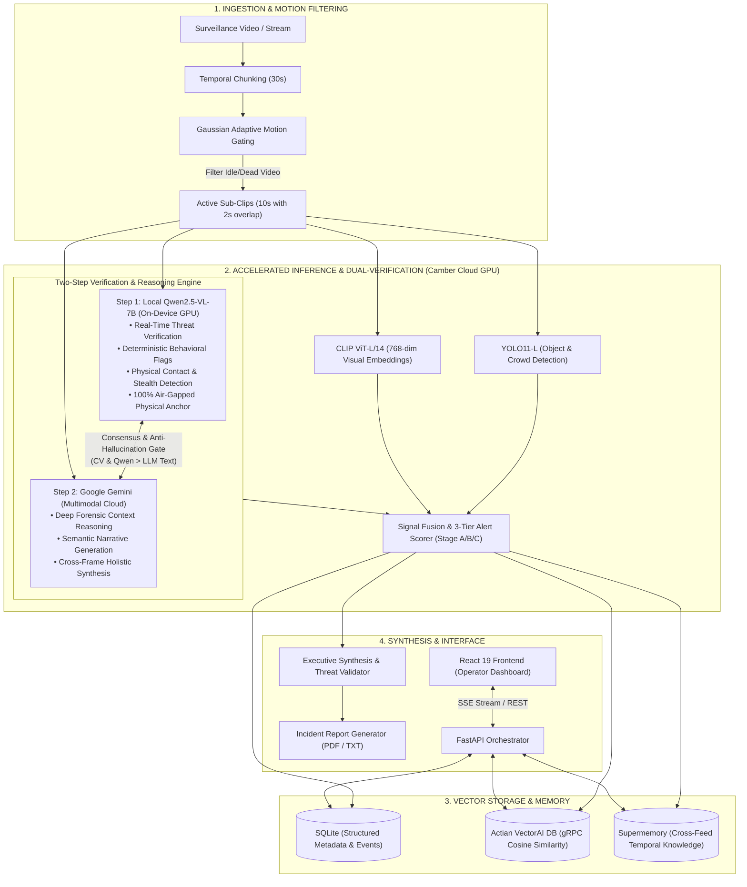

# LensQL AI — Autonomous Surveillance Intelligence & Natural-Language Video Query Engine

> **Transforming passive CCTV cameras into proactive, real-time threat intelligence and natural-language searchable video infrastructure.**

[](https://camber.cloud)
[](https://huggingface.co/Qwen/Qwen2.5-VL-7B-Instruct)
[](https://deepmind.google/gemini)
[](https://actian.com)
[](https://supermemory.ai)
[](https://fastapi.tiangolo.com)
[](https://react.dev)

---

## 📌 Executive Summary & The Problem

Over **1 billion CCTV cameras** are deployed worldwide today, recording millions of hours of surveillance footage every single hour. Yet:
- **99% of surveillance video is never watched live**: Human security operators experience visual fatigue within 20 minutes of monitoring split screens.
- **Dumb Motion Sensors Cause Alarm Fatigue**: Conventional cameras trigger false alerts from headlights, tree shadows, weather, and insects.
- **Forensic Video Scrubbing is Slow and Painful**: When an incident occurs (theft, physical assault, intrusion), operators spend hours manually scrubbing timelines across dozens of camera feeds.
- **CCTV is a Reactive "Dumb Recorder"**: Current video management systems (VMS) act as digital tape recorders that only record crimes rather than proactively flagging threats and extracting queryable knowledge.

**LensQL AI solves this paradigm.**

LensQL AI turns raw, unstructured surveillance video streams into **structured, semantically indexed intelligence**. It automatically isolates motion windows, runs high-speed object and anomaly detection, generates forensic descriptions, indexes multi-modal embeddings in **Actian VectorAI DB**, and enables security operators to interrogate hours of footage in plain conversational English through a ChatGPT-style interface with instant sub-second response times.

---

## 🏢 Real-World Use Cases

```
┌─────────────────────────────────────────────────────────────────────────────┐
│                            REAL-WORLD APPLICATIONS                          │
└───────┬─────────────────────────┬─────────────────────────┬─────────────────┘
        │                         │                         │
        ▼                         ▼                         ▼
┌───────────────┐         ┌───────────────┐         ┌───────────────┐
│ Retail & Loss │         │ Public Safety │         │  Industrial & │
│  Prevention   │         │ & Smart City  │         │  Perimeter    │
├───────────────┤         ├───────────────┤         ├───────────────┤
│• Shoplifting  │         │• Assault &    │         │• After-hours  │
│  motion cues  │         │  fight alert  │         │  trespassing  │
│• Loitering at │         │• Abandoned    │         │• Hazard & PPE │
│  checkout     │         │  bag / item   │         │  violations   │
│• Night-time   │         │• Crowd crush  │         │• Vehicle gate │
│  intrusion    │         │  surges       │         │  anomalies    │
└───────────────┘         └───────────────┘         └───────────────┘
```

1. **Retail & Loss Prevention**
   - Automatically detects suspicious behavioral cues (rapid concealment of goods, erratic pacing near high-value displays, after-hours movement).
   - Generates automated evidence clips with exact timestamps for store managers and insurance adjusters.
2. **Public Transit & Smart Cities**
   - Instantly flags physical altercations, aggressive contact, and sudden crowd surges on train platforms or bus terminals.
   - Detects unattended luggage or suspicious stationary objects in high-traffic concourses.
3. **Critical Industrial Facilities & Warehouses**
   - Monitors restricted perimeter boundaries during scheduled non-operational hours (`after_hours` heuristic).
   - Audits dock activity and flags unauthorized personnel without requiring dedicated guards at every monitor.
4. **Law Enforcement & Forensic Investigation**
   - Eliminates 95% of video scrubbing time. Investigators can ask:
     > *"Show me anyone wearing a black hoodie who entered through the back exit between 2:00 AM and 4:00 AM"*
     LensQL retrieves the exact video clips in milliseconds via multi-modal vector search.

---

## 🏗️ System Architecture

LensQL AI employs a **multi-tier hierarchical processing pipeline** designed to balance real-time throughput, GPU resource utilization, and deep reasoning accuracy.



### Architectural Highlights

1. **Adaptive Motion Gating (80% Compute Savings)**:
   Surveillance cameras frequently record hours of empty rooms or static corridors. LensQL’s motion-difference gating isolates only active windows, dropping idle frames before any heavy neural network is invoked.
2. **Two-Step Dual Verification Engine (Beyond Naive API Wrappers)**:
   Generic "LLM wrappers" that simply pipe raw video to a cloud API fail in mission-critical surveillance: they suffer from network latency, API rate limits, privacy leaks, and dangerous **visual hallucinations** (e.g., misinterpreting an assault as "playful wrestling" or item concealment as "browsing"). LensQL deploys a rigorous two-step verification pipeline:
   - **Step 1 — Local GPU Verification (`Qwen2.5-VL-7B`)**: Runs locally in GPU VRAM (BF16) on raw uncompressed frames. Evaluates physical optical motion, proximity metrics, and extracts ground-truth boolean threat flags (`is_fighting`, `is_stealing`, `is_erratic`). Zero latency, zero data egress.
   - **Step 2 — Semantic Contextual Reasoning (`Google Gemini`)**: Cross-examines the candidate event against situational context, facility type, and after-hours rules to generate an executive forensic narrative.
   - **Consensus & Authority Chain**: Computer vision detections and local VLM flags take precedence over generative text:
     $$\text{YOLO / CV Detections (Authoritative)} \;\gt\; \text{Qwen VLM Flags (Ground Truth)} \;\gt\; \text{Gemini Text Caption}$$
     If Gemini under-calls an incident (e.g., labeling an event "normal_activity"), the programmatic safety net detects the conflict ($\ge 30\%$ threat CV labels) and automatically overrides intent and escalates severity.
3. **Flexible Operating Modes**:
   - **Mode 1: Hybrid Dual-Consensus (Standard)**: Pairs local Qwen2.5-VL physical verification on Camber GPU with Gemini's high-level narrative synthesis.
   - **Mode 2: Air-Gapped Sovereign (Gov / Defense / Banking)**: 100% on-premise execution powered entirely by Qwen2.5-VL, YOLO11, and CLIP on Camber GPU with zero external network calls.
   - **Mode 3: High-Throughput Cloud (Edge-Optimized)**: Lightweight edge motion gating with direct cloud multimodal streaming for resource-constrained edge hubs.
4. **High-Dimensional Semantic Storage (Actian VectorAI DB)**:
   Every sub-clip is transformed into a 768-dimensional normalized embedding via OpenAI's CLIP ViT-L/14. Actian VectorAI DB indexes these embeddings with sub-50ms cosine similarity search, allowing free-form natural language querying without relying on fixed metadata tags.
5. **Two-Phase SSE Streaming Chat**:
   Security operators get instant visual feedback. When querying the chat:
   - **Phase 1 (~100-200ms)**: Actian VectorAI returns matching clip cards with timestamps and alert badges.
   - **Phase 2 (streaming)**: Gemini streams the analytical narrative explaining what occurred in those clips.

---

## ⚡ Deployment & Infrastructure Options

LensQL AI is designed with an infrastructure-agnostic compute architecture. You can run the neural inference and forensic consensus pipeline across your preferred environment based on budget, hardware availability, and scalability requirements:

| Environment | Ideal For | GPU Setup | Setup Time | Cost |
|---|---|---|---|---|
| **[Option A: Camber Cloud GPU](#option-a-camber-cloud-gpu-recommended-for-production)** | Dedicated Production & 24/7 Live Monitoring | Dedicated NVIDIA L4 / A100 | ~3 mins | Pay-as-you-go |
| **[Option B: Google Colab](#option-b-google-colab-free-zero-setup-quickstart)** | Fast Demo, Interactive Testing & Hackathons | Free NVIDIA T4 GPU | ~2 mins | Free |
| **[Option C: Modal Serverless](#option-c-modal-serverless-gpu-auto-scaling)** | Serverless Auto-scaling & Distributed Pipelines | Serverless On-Demand A10G / T4 | ~4 mins | Usage-based |
| **[Option D: Local / Bare Metal](#option-d-local-workstation--bare-metal)** | Air-gapped / Sovereign On-Premises | Local NVIDIA GPU (RTX 3060+) or CPU | ~5 mins | Self-hosted |

---

### Option A: Camber Cloud GPU (Recommended for Production)

Camber Cloud provides dedicated NVIDIA GPUs (L4 / A100) with zero serverless cold starts and without aggressive credit card restrictions.

```
┌────────────────────────────────────────────────────────┐                 ┌─────────────────────────────┐
│                   Camber Cloud GPU                     │                 │       Operator Client       │
│  ┌──────────────────────────────────────────────────┐  │                 │  ┌───────────────────────┐  │
│  │ A100 / L4 GPU VRAM Footprint (~19 GB)            │  │                 │  │ React 19 Frontend     │  │
│  │  • YOLO11-L           ~2.0 GB   (Object/Motion)  │  │                 │  │ (Dashboard & Chat)    │  │
│  │  • CLIP ViT-L/14      ~1.5 GB   (768d Vector)    │  │                 │  └───────────▲───────────┘  │
│  │  • Qwen2.5-VL-7B      ~15.5 GB  (Local VLM)      │  │                 │              │              │
│  │                                                  │  │                 │              │              │
│  │ FastAPI + Dual-Verification Consensus Engine     │  │                 │              │              │
│  └──────────────────────────┬───────────────────────┘  │                 │              │              │
│                             │                          │                 │              │              │
│                             ▼                          │                 │              │              │
│  ┌──────────────────────────────────────────────────┐  │  HTTPS Tunnel   │              │              │
│  │ Cloudflare / ngrok Tunnel (Public HTTPS Endpoint)├──┼─────────────────┼──────────────┘              │
│  └──────────────────────────────────────────────────┘  │                 │                             │
└────────────────────────────────────────────────────────┘                 └─────────────────────────────┘
```

1. **Launch GPU Instance**:
   Create an on-demand GPU instance on [Camber Cloud](https://camber.cloud) (Ubuntu 22.04 + NVIDIA Drivers).

2. **Clone & Install Dependencies**:
   ```bash
   git clone https://github.com/pkprajapati7402/LensQL-AI.git
   cd LensQL-AI/backend
   pip install -r requirements.txt
   ```

3. **Configure Environment Variables (`backend/.env`)**:
   ```bash
   cp .env.example .env
   # Add your Google Gemini API Key
   GEMINI_API_KEY=your_gemini_api_key_here
   SUPERMEMORY_API_KEY=your_supermemory_key_here # Optional
   ```

4. **Start Backend & Tunnel**:
   ```bash
   # Terminal 1: Run FastAPI server
   uvicorn api.main:app --host 0.0.0.0 --port 8000

   # Terminal 2: Expose secure public endpoint via Cloudflare Tunnel
   cloudflared tunnel --url http://localhost:8000
   # Logs will output: https://<random-subdomain>.trycloudflare.com
   ```

---

### Option B: Google Colab (Free Zero-Setup Quickstart)

If you don't have a local GPU or cloud credit, you can run the entire backend on Google Colab's free NVIDIA T4 GPU instance.

1. **Open Google Colab**:
   Navigate to [Google Colab](https://colab.research.google.com) and create a **New Notebook**.
2. **Set Hardware Accelerator**:
   Go to **Runtime** > **Change runtime type** > Select **T4 GPU** > Save.
3. **Execute Setup Cell in Colab**:
   ```python
   # 1. Clone repository
   !git clone https://github.com/pkprajapati7402/LensQL-AI.git
   %cd LensQL-AI/backend

   # 2. Install dependencies & Cloudflare Tunnel binary
   !pip install -r requirements.txt
   !wget -q https://github.com/cloudflare/cloudflared/releases/latest/download/cloudflared-linux-amd64.deb
   !dpkg -i cloudflared-linux-amd64.deb

   # 3. Configure API Key
   import os
   os.environ["GEMINI_API_KEY"] = "your_gemini_api_key_here"

   # 4. Start Cloudflare Tunnel in background
   !nohup cloudflared tunnel --url http://127.0.0.1:8000 > tunnel.log 2>&1 &
   !sleep 3 && grep -o "https://.*\.trycloudflare\.com" tunnel.log

   # 5. Launch FastAPI backend
   !uvicorn api.main:app --host 0.0.0.0 --port 8000
   ```
4. **Copy the Tunnel URL**:
   The notebook will output a live HTTPS URL (e.g. `https://random-words.trycloudflare.com`). Use this URL to connect your frontend!

---

### Option C: Modal Serverless (GPU Auto-Scaling)

Modal allows you to run distributed GPU workloads with automatic scaling and zero idle cost.

1. **Install and Authenticate Modal**:
   ```bash
   pip install modal
   modal setup
   ```

2. **Download Model Weights to Modal Persistent Volume**:
   ```bash
   # Downloads YOLO and CLIP weights to Modal Volume 'vigilant-model-weights'
   modal run backend/workers/inference.py::download_models
   ```

3. **Deploy the Pipeline**:
   ```bash
   modal deploy backend/workers/inference.py
   ```

4. **Run Local FastAPI Backend with Modal Integration**:
   ```bash
   cd LensQL-AI/backend
   export GEMINI_API_KEY=your_gemini_api_key_here
   uvicorn api.main:app --reload --port 8000
   ```
   The backend will automatically route heavy video subclip extraction jobs to your distributed Modal workers.

---

### Option D: Local Workstation / Bare Metal

For local developer machines with an NVIDIA GPU (e.g. RTX 3060 / 4070 / 4090) or running in CPU-fallback mode:

1. **Install Requirements**:
   ```bash
   cd LensQL-AI/backend
   python -m venv venv
   source venv/bin/activate  # On Windows: .\venv\Scripts\activate
   pip install -r requirements.txt
   ```

2. **Set Environment Variables in `backend/.env`**:
   ```bash
   GEMINI_API_KEY=your_gemini_api_key_here
   ```

3. **Launch the Server**:
   ```bash
   uvicorn api.main:app --host 0.0.0.0 --port 8000 --reload
   ```

---

### 🌐 Connecting the React 19 Frontend

Once your backend is running (locally or through a Cloudflare/ngrok tunnel):

1. **Navigate to the frontend directory**:
   ```bash
   cd LensQL-AI/lensql-ai
   npm install
   ```

2. **Configure the Backend URL**:
   Set `VITE_BACKEND_URL` in your terminal or inside `lensql-ai/vite.config.ts`:
   ```bash
   # If running backend via Cloudflare Tunnel (Colab / Camber Cloud):
   export VITE_BACKEND_URL=https://your-unique-subdomain.trycloudflare.com

   # If running backend locally on the same machine:
   # Defaults automatically to http://localhost:8000 via proxy
   ```

3. **Start the Development Server**:
   ```bash
   npm run dev
   ```
   Open `http://localhost:5173` in your browser. Alternatively, paste your tunnel URL into the **Settings** tab in the LensQL AI console anytime to re-point feeds live.

---

## 🔬 Multi-Stage Alert Matrix

Every clip is evaluated across physical motion magnitude, spatial overlap, person-to-person proximity, and temporal duration (`dwell_time`):

| Alert Stage | UI Indicator | Severity | Trigger Criteria | Action Taken |
|---|---|---|---|---|
| **Stage A** | 🟡 Yellow Badge | Suspicious Activity | Alert Score $\ge 0.40$ (Unusual dwell time, solitary presence after hours) | Logged to event index, flagged in timeline |
| **Stage B** | 🟠 Orange Badge | Concerning Behavior | Alert Score $\ge 0.65$ (Rapid item concealment, aggressive posture, restricted zone) | Immediate notification, priority card in dashboard |
| **Stage C** | 🔴 Pulsing Red Alert | Critical Incident | Alert Score $\ge 0.85$ (Physical altercation, weapon signature, intrusion breach) | Header alert beacon, ambient glow, instant incident dossier generation |

---

## 🛠️ Complete Tech Stack

| Domain | Technology | Role & Justification |
|---|---|---|
| **GPU Compute** | **Camber Cloud GPU** (NVIDIA L4 / A100) / Modal | High-throughput GPU execution for parallel deep learning inferences without credit card barriers. |
| **Vector Database** | **Actian VectorAI DB** | High-performance, purpose-built vector store communicating via gRPC. Sub-50ms cosine similarity search across 768-dim embeddings. |
| **Object Detection** | **YOLO11-L** | State-of-the-art real-time object, person, and vehicle detection with sub-15ms inference latency. |
| **Semantic Embedding** | **OpenAI CLIP ViT-L/14** | Multi-modal alignment model mapping video frames and text prompts into a shared 768-dimensional latent space. |
| **Local Physical VLM (Step 1)** | **Qwen2.5-VL-7B-Instruct** | On-device 7B vision-language model in BF16 (~15.5GB VRAM). Extracts ground-truth physical threat flags (`is_fighting`, `is_stealing`) with zero data egress. |
| **Multimodal Reasoning (Step 2)** | **Google Gemini 2.5 Flash Vision** | Deep multimodal vision analysis generating forensic descriptions, cross-validating physical signals, and identifying behavioral context. |
| **Synthesis Reasoning**| **Google Gemini 2.5 Flash** | Synthesizes hundreds of clip detections into executive summaries, risk levels, and identified perpetrator/victim dynamics. |
| **Temporal Memory** | **Supermemory** | Cross-video persistent memory engine enabling natural language queries across weeks of historical camera data. |
| **API Orchestrator** | **FastAPI (Python 3.11)** | High-performance asynchronous web framework providing Server-Sent Events (SSE) for two-phase streaming responses. |
| **Structured Store** | **SQLite3** | Zero-latency local storage for fast timeline filtering, clip metadata, and event histories. |
| **Frontend UI** | **React 19 + TypeScript** | Responsive security command center with real-time video playback and chat timeline integration. |
| **Styling & Motion** | **Tailwind CSS v4** | Modern design language utilizing hardware-accelerated animations and ambient alert states. |

---

## 📂 Project Organization

```
LensQL-AI/
├── backend/
│   ├── api/
│   │   └── main.py              # REST API & Server-Sent Events (SSE) engine
│   ├── services/
│   │   ├── vectordb.py          # Actian VectorAI DB gRPC client & collection manager
│   │   ├── clip_search.py       # Hybrid CLIP vector search + keyword fallback
│   │   ├── gemini_synthesis.py  # Executive risk synthesis & threat validation
│   │   ├── incident_report.py   # Automated PDF/TXT legal incident report exporter
│   │   ├── ingest.py            # Event aggregation & embedding pipeline
│   │   └── db.py                # Relational schema for videos, alerts, and chat
│   ├── workers/
│   │   ├── pipeline.py          # Adaptive motion gating, temporal chunking & alerts
│   │   └── inference.py         # Multi-model GPU inference pipeline (YOLO, CLIP, VLM)
│   ├── uploads/                 # Temporary streaming buffer for raw video files
│   └── requirements.txt         # Python dependencies
│
├── lensql-ai/                   # React 19 Client
│   ├── src/
│   │   ├── pages/
│   │   │   ├── HomePage.tsx     # Surveillance feed grid & global cross-camera search
│   │   │   ├── VideoPage.tsx    # Live investigation terminal, timeline & video player
│   │   │   └── BenchmarkPage.tsx# GPU compute & Actian VectorAI latency telemetry
│   │   ├── api.ts               # Type-safe API client and SSE stream parser
│   │   └── index.css            # Custom theme definitions & pulsing alert animations
│   ├── vite.config.ts           # Proxy configuration & tunnel endpoints
│   └── package.json
│
└── actian-vectorAI-db-beta/     # Actian VectorAI Docker service & gRPC client wheel
```

---

## 🚀 Quickstart Guide

### Prerequisites
- Python 3.10+
- Node.js 18+
- Docker (for local Actian VectorAI instance)
- Google Gemini API Key ([Google AI Studio](https://aistudio.google.com))

### 1. Start Actian VectorAI DB (Docker)
```bash
cd actian-vectorAI-db-beta
docker compose up -d
# VectorAI service starts on localhost:50051 (gRPC)
```

### 2. Configure & Launch Backend
```bash
cd ../backend

# Create virtual environment
python -m venv .venv
source .venv/Scripts/activate # Windows: .venv\Scripts\activate

# Install dependencies & Actian client
pip install -r requirements.txt
pip install ../actian-vectorAI-db-beta/actiancortex-0.1.0b1-py3-none-any.whl

# Configure Environment
echo "GEMINI_API_KEY=your_key_here" > .env

# Run FastAPI Server
uvicorn api.main:app --reload --port 8000
```

### 3. Launch Frontend
```bash
cd ../lensql-ai
npm install
npm run dev
# Open http://localhost:5173
```

---

## 🌐 API Reference

| Method | Route | Description |
|---|---|---|
| `POST` | `/api/upload` | Upload surveillance video (up to 5GB) and begin automated pipeline |
| `GET` | `/api/upload/status/{id}` | Real-time progress and job state polling |
| `GET` | `/api/videos` | Retrieve all processed video surveillance sessions |
| `GET` | `/api/videos/{id}/events` | Fetch all indexed sub-clip events with bounding detections |
| `GET` | `/api/videos/{id}/alerts` | Filtered list of Stage A, B, and C threat incidents |
| `GET` | `/api/videos/{id}/summary` | AI-generated executive narrative, behavioral intent, and key moments |
| `GET` | `/api/videos/{id}/report` | Download formal incident report (`format=pdf` or `format=txt`) |
| `GET` | `/api/chat/stream` | Server-Sent Events (SSE) semantic video search stream |
| `POST` | `/api/memory/query` | Cross-video intelligence query over Supermemory |
| `GET` | `/api/benchmarks/vectorai` | Live Actian VectorAI query latency and vector density stats |

---

## 🔮 Enterprise Roadmap & CCTV Scalability

> **For an in-depth architectural and commercial deep dive, read [SCALABILITY.md](file:///c:/Users/princ/Documents/GitHub/Vigilant/SCALABILITY.md)**, which details the **5-Camera Cafe Case Study**, two-tier reflex/reasoning alert design, unit economics, edge fog computing, and Kafka/Camber GPU scaling.

To transition LensQL AI from a single-feed system to an **enterprise-wide Smart City / Multi-Facility Video Management System (VMS)**, the following architectural scaling path is established:

1. **RTSP / ONVIF Live Stream Ingestion**
   - Replace file uploads with live camera streams via RTSP/WebRTC ingested through GStreamer / FFmpeg pipelines into distributed frame ring buffers.
2. **Edge-to-Cloud Fog Computing**
   - Deploy lightweight edge inferencing (NVIDIA Jetson Orin / on-camera NPUs) running motion gating and quantized YOLO11 (INT8 via TensorRT).
   - Only suspicious candidate frames are transmitted upstream to the Camber GPU cluster, reducing bandwidth consumption by over 90%.
3. **Cross-Camera Multi-Target Tracking & Re-Identification (Re-ID)**
   - Extract appearance feature vectors to track individuals or vehicles across non-overlapping camera fields of view (e.g., following a suspect from Parking Lot → West Entrance → Elevator Lobby).
4. **Automated Incident Dispatch Webhooks**
   - Configure instant Stage C dispatch webhooks into enterprise incident management platforms (Slack, PagerDuty, Genetec Security Center, Milestone XProtect, or 911 dispatch CAD systems).
5. **Horizontal Worker Auto-Scaling**
   - Decouple video decoding and inference using an event bus (Apache Kafka / Redis Streams) and auto-scale Camber GPU worker nodes based on stream backlog using Kubernetes (KEDA).

---

## 📄 License
This project is licensed under the MIT License.
